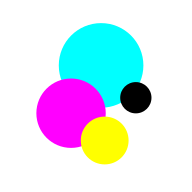

# Dot Plotter



Dot Plotter is a GCODE toolpath generator for CMYK stippling. It splits an image into Cyan, Magenta, Yellow and Black components, creates a set of dots representing each component colour, then generates a GCODE toolpath that a robot holding a pen of each colour can run.

## Usage

- **Image** - Start by opening an image, or drop one anywhere on the page. Any format your browser can display works. Images larger than 4096 px on a side are scaled down for processing.

- **Layers** - The image is split into four ink layers. **Image** shows a layer's ink coverage; **Dots** shows the dots from the last generate. Visibility only affects the preview, not the output files.
  **Note:** RGB to CMYK conversion is done mathematically. ICC colour profiles are not supported yet.

- **Preview** - Shows the visible layers multiplied onto white paper, roughly how overlapping inks mix.

- **Output**
  - **Stock Width/Height** - The size of the sheet you plan to plot on, in mm. The two are linked to keep the image's aspect ratio.
  - **Tool Diameter** - The width of your pen's tip. This sets the dot spacing: one possible dot per tool diameter in each direction.
  - **Travel/Plunge Feedrates** - How fast the robot moves between dots, and when pressing the pen onto the paper, in mm/min.
  - **Travel/Plunge Heights** - The Z height to lift the pen to when travelling, and the Z height to press down to, *relative to the machine origin*. These don't account for paper thickness.
  - **Generate G-code** - Builds the dots and toolpaths for all four layers in a background worker.
  - **Download ZIP** - Saves a ZIP with one `.gcode` file per layer.

Each G-code file homes the machine (`G28`), then visits its dots row by row, alternating direction on each row so the pen doesn't travel back across the sheet.

## Development

Requires Node.js 20.19 or later.

```bash
npm install
npm run dev        # start the dev server
npm test           # run unit tests
npm run lint
npm run build      # type-check and build to dist/
```

### Layout

- `src/core/` - The algorithm as plain functions over typed arrays: CMYK separation, resampling, stippling, G-code and dot rendering. No DOM or React, and unit-tested.
- `src/worker/` - The Web Worker that runs the core off the main thread, plus a typed client for it.
- `src/state/` - App state (Zustand).
- `src/components/` - The React UI.

## Planned Improvements

- **ICC Profiles** - Use ICC profiles to convert from RGB to CMYK for better colour accuracy.
- **Tool Diameter by Layer** - Allow a different tool diameter for each layer.
- **Better stippling** - Error diffusion or blue-noise dithering instead of independent random dots.
